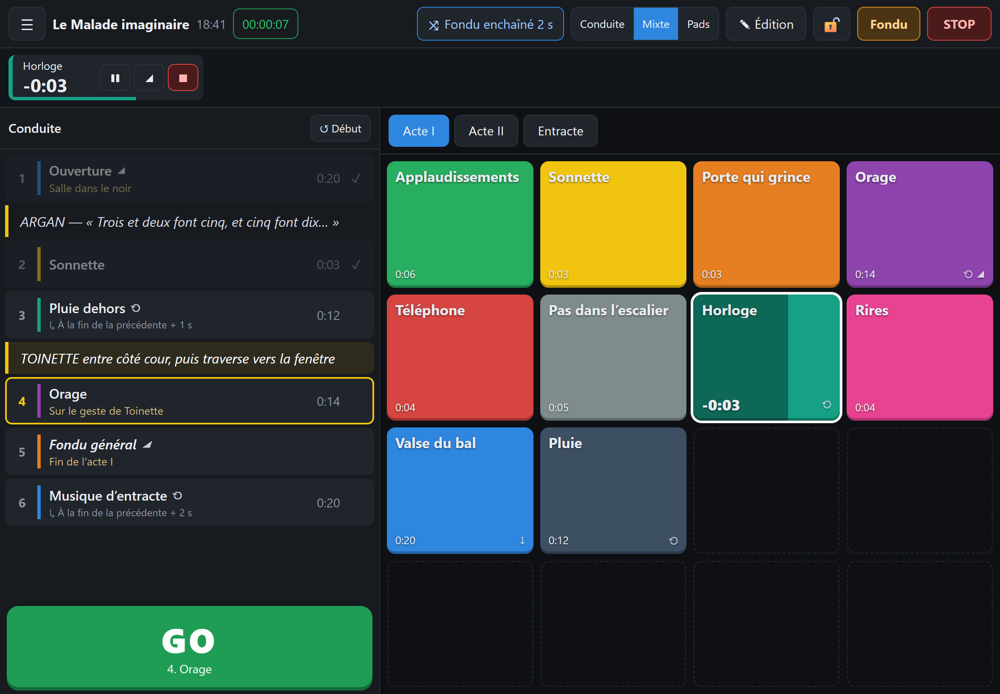
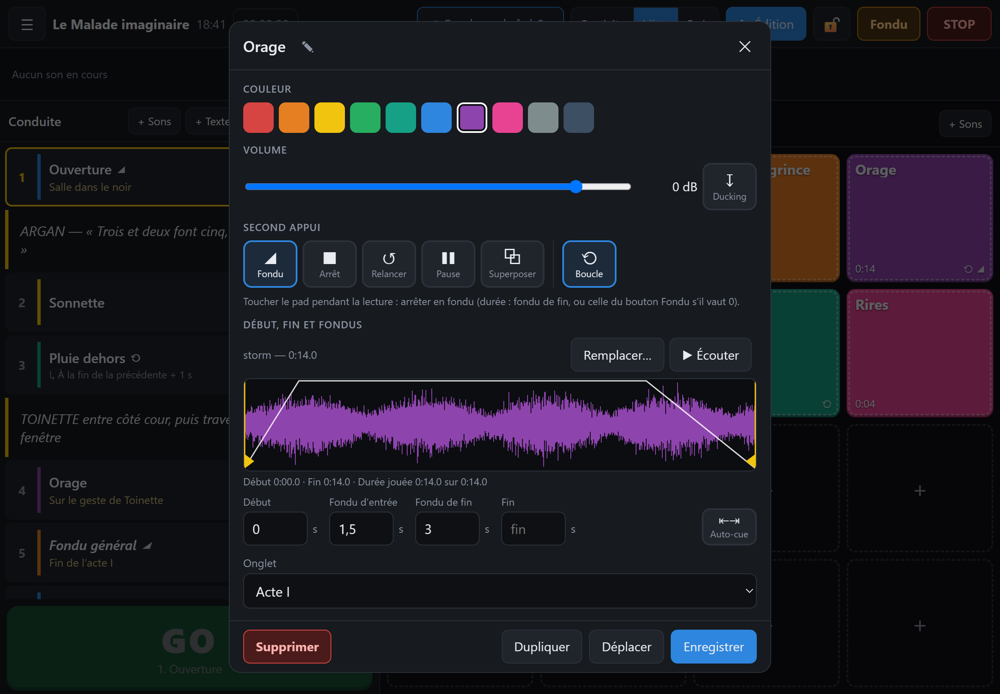

# Jinglee

Lecteur de jingles et de conduites sonores pour le **théâtre** et le **podcast**.
Libre, gratuit, sans compte, et conçu pour les tablettes, y compris les anciennes (iPad mini 4 sous iPadOS 15, iPad sous iOS 12 ou 13, vieux Android).

Jinglee est une application web installable (PWA) : on l'ouvre une fois dans le navigateur, on l'ajoute à l'écran d'accueil, et elle fonctionne ensuite **hors-ligne**. Les sons restent sur la tablette.

**👉 Utiliser Jinglee : https://mathgen44.github.io/jinglee/**



## Fonctionnalités

### En spectacle

- **Pads** : grille de jingles en couleur, organisée en onglets, déclenchés d'un simple toucher.
  Un second toucher arrête le son **en fondu** (par défaut), ou au choix l'arrête net, le relance, le met en pause ou lance une lecture de plus.
- **Conduite** avec un grand bouton **GO** : la cue en attente est surlignée, avec ses notes de régie.
  Enchaînements automatiques « avec la précédente » ou « à la fin de la précédente », avec délai.
  Actions « fondu général » et « arrêt général ».
- **Lignes de texte** dans la conduite (réplique, mouvement, repère) : GO les saute, et le texte qui annonce la cue en attente est surligné.
- **Mode de transition** dans la barre du haut : superposer les sons, **fondu enchaîné** (durée réglable) ou couper le précédent.
- **Bandeau « En cours »** : tous les sons qui jouent, avec temps restant, pause, fondu et arrêt individuels.
- **Boutons de sécurité** : FONDU (durée réglable) et STOP général, **verrouillage** du mode spectacle.
- Trois vues : **Conduite**, **Mixte** (conduite + pads) et **Pads**, en paysage comme en portrait.
- Chronomètre de spectacle et horloge.
- Clavier ou pédale Bluetooth : `Espace` / `Page suivante` = GO, flèches = cue en attente, `Échap` = fondu, `Maj+Échap` = stop.

### Préparation



- **Réglages par son** : nom, couleur, volume, comportement au second appui, boucle.
- **Frise avec la forme d'onde** : on fait glisser les poignées de début et de fin au doigt ; fondus et lecture en cours y sont dessinés.
- **Auto-cue** : place le début et la fin là où le son commence et s'arrête (retire les silences).
- **Fondus** d'entrée et de fin, **ducking** (baisse automatique des autres sons), arrêt des autres sons au départ d'une cue.
- **Projets** multiples, export et import dans un fichier `.jinglee` (un ZIP standard contenant `project.json` et les sons).
- Formats : MP3, M4A/AAC, WAV, AIFF, CAF, FLAC (selon ce que l'appareil sait lire).

## Installation sur une tablette

1. Ouvrez **https://mathgen44.github.io/jinglee/** :
   - sur iPad / iPhone dans **Safari**, touchez *Partager* → *Sur l'écran d'accueil* (un bandeau le rappelle tant que Jinglee n'est pas installé) ;
   - sur Android dans **Chrome**, touchez *Installer* dans le bandeau ou le menu ;
   - sur ordinateur dans Chrome ou Edge, cliquez sur l'icône d'installation dans la barre d'adresse.
2. Lancez Jinglee depuis l'icône : c'est cette version installée qui garde vos sons et fonctionne hors-ligne.
3. Touchez **✎ Édition**, puis une case vide ou **+ Sons** pour importer vos fichiers.

> Sur iOS, l'application installée et Safari ont des données séparées : importez vos sons depuis l'application installée
> (ou exportez votre projet depuis Safari et réimportez-le dans l'application).

## Version pour ordinateur (Windows, Mac)

Jinglee existe aussi en application à installer, pratique pour une régie sur ordinateur portable :
mêmes fonctions, aucune connexion nécessaire, pas de mise en veille de l'écran tant que Jinglee est ouvert,
et beaucoup plus de sons gardés prêts en mémoire (jusqu'à 2 Go selon l'ordinateur).

**👉 [Dernière version pour ordinateur](https://github.com/mathgen44/jinglee/releases/latest)**

| Ordinateur | Fichier à prendre |
|---|---|
| Windows 10 ou 11 | `Jinglee-…-Windows-installation.exe` |
| Windows, sans rien installer (clé USB, ordinateur prêté) | `Jinglee-…-Windows-portable.exe` |
| Mac (Intel ou Apple Silicon), macOS 12 ou plus récent | `Jinglee-…-Mac.dmg` |
| Mac plus ancien : macOS 10.13 High Sierra à macOS 11 Big Sur | `Jinglee-…-Mac-ancien.dmg` |

- **Windows** : si Windows affiche « Windows a protégé votre ordinateur », cliquez sur **Informations complémentaires**
  puis **Exécuter quand même** (ce message apparaît pour les logiciels gratuits sans certificat Microsoft payant).
- **Mac** : ouvrez le `.dmg` et glissez Jinglee dans Applications. Au premier lancement, macOS le bloque car il
  n'est pas enregistré auprès d'Apple (c'est payant) :
  - macOS 15 et plus récent : *Réglages Système → Confidentialité et sécurité* → **Ouvrir quand même** ;
  - macOS 14 et plus ancien : **Ctrl + clic** sur Jinglee dans Applications → **Ouvrir**.

  Si macOS indique que Jinglee « est endommagé », ouvrez le Terminal et lancez `xattr -cr /Applications/Jinglee.app`.

Les projets se transportent entre tablette et ordinateur avec l'export `.jinglee` (*Menu ☰ → Exporter*) ;
sur ordinateur, un double-clic sur un fichier `.jinglee` l'ouvre dans Jinglee.
Au lancement, Jinglee signale s'il existe une nouvelle version ; rien ne s'installe tout seul.

### Signaler un problème

*Menu ☰ → Signaler un problème* prépare un rapport : votre description, la version de Jinglee, l'appareil,
le navigateur et les dernières erreurs rencontrées (sans noms de projets ni de fichiers). Vous pouvez le relire avant
de l'envoyer. **Envoyer sur GitHub** ouvre une [issue](https://github.com/mathgen44/jinglee/issues) déjà remplie
(compte GitHub gratuit nécessaire) ; **Copier le rapport** permet de l'envoyer autrement.

### Mises à jour

L'application vérifie s'il existe une nouvelle version à chaque retour au premier plan et affiche un bandeau
**« Mettre à jour »**. Elle ne se recharge jamais seule, pour ne pas couper un son pendant un spectacle.
Le numéro de version est indiqué en bas du menu ☰.

### Conseils pour le spectacle

- Réglez le **verrouillage automatique** de la tablette sur **Jamais** : le son s'arrête si l'écran se verrouille.
  Jinglee empêche déjà la mise en veille (état visible dans *Menu → Réglages*), mais ce réglage reste la meilleure garantie.
- Activez le mode avion ou « Ne pas déranger » pour éviter les notifications sonores.
- **Verrouillez** l'application (cadenas) pendant la représentation : plus aucune modification possible par erreur.
- **Exportez** votre projet après chaque modification importante : c'est votre sauvegarde.
- Import depuis Google Drive ou un autre service : l'appareil télécharge d'abord chaque fichier en entier
  avant de le transmettre à Jinglee, ce qui peut être long (Jinglee affiche une fenêtre d'attente).
  Pour aller plus vite, copiez d'abord vos sons dans *Fichiers → Sur mon iPad*, ou préparez le projet sur un ordinateur
  et importez le fichier `.jinglee` sur la tablette.
  Si vos MP3 apparaissent grisés dans le sélecteur, cochez *Menu → Réglages → Montrer tous les fichiers à l'import*.
- Les sons sont décodés en mémoire pour un départ instantané, dans une limite stricte (200 Mo sur iPad,
  soit environ 18 minutes de stéréo ; 350 Mo ailleurs). Restent prêts en priorité la cue en attente et les
  suivantes, puis les pads de l'onglet affiché, des plus courts aux plus longs. Un son qui n'a pas pu être gardé
  est rechargé quand on le joue : une à deux secondes pour un long morceau sur un iPad ancien.
  L'occupation est visible dans *Menu → Réglages*. Pour un spectacle chargé, répartissez les longs morceaux
  sur plusieurs onglets ou mettez-les dans la conduite.

## Développement

Aucune dépendance ni étape de compilation : HTML, CSS et JavaScript (modules ES) compatibles Safari 15.

```bash
python -m http.server 8642
```

Puis ouvrez http://localhost:8642.

Le service worker (cache hors-ligne) n'est activé qu'en HTTPS, donc pas en local. À chaque version publiée,
changez la constante `CACHE` dans `sw.js` (et `VERSION` dans `js/main.js`) : c'est ce qui déclenche la mise à jour
sur les appareils déjà installés.

L'application de bureau reprend ces mêmes fichiers dans une fenêtre Electron (dossier `desktop/`, Node.js 22) :

```bash
npm install
npm start          # lancer l'application
npm run selftest   # test de démarrage automatique (capture dans selftest-out/)
npm run dist:win   # construire l'installateur Windows dans dist/
```

Pour publier une version pour ordinateur, mettez le même numéro dans `package.json` que dans `js/main.js`,
puis poussez une étiquette : `git tag v1.5.1 && git push origin v1.5.1`. GitHub construit alors les fichiers
Windows et Mac et les publie dans les [versions](https://github.com/mathgen44/jinglee/releases)
(`.github/workflows/release.yml`).

| Fichier | Rôle |
|---|---|
| `js/audio.js` | Moteur Web Audio : décodage, cache, voix, fondus, ducking |
| `js/show.js` | Logique de spectacle : pads, GO, enchaînements, transitions |
| `js/main.js` | État de l'application, écran principal, menus, mises à jour |
| `js/editor.js` | Fenêtre de réglage d'un pad ou d'une cue |
| `js/timeline.js` | Frise : forme d'onde, poignées, auto-cue |
| `js/model.js` | Modèle de données d'un projet |
| `js/db.js` | Stockage IndexedDB |
| `js/archive.js`, `js/zip.js` | Export / import `.jinglee` |
| `js/device.js` | Anti-veille, session audio iOS |
| `js/install.js` | Bandeau d'invitation à installer |
| `desktop/` | Application de bureau (Electron) : fenêtre, accès aux fichiers, mises à jour |
| `tools/make_assets.py` | Génère les icônes et `js/media.js` |
| `tools/screenshots.py` | Régénère les captures de `docs/` (ffmpeg + Chrome) |

Pour régénérer les médias embarqués (nécessite ffmpeg et Pillow) :

```bash
ffmpeg -f lavfi -i color=c=black:s=16x16:r=1 -t 2 -c:v libx264 -profile:v baseline -pix_fmt yuv420p -an assets/keepawake.mp4
ffmpeg -f lavfi -i anullsrc=r=22050:cl=mono -t 1 -c:a libmp3lame -b:a 32k assets/silence.mp3
python tools/make_assets.py
```

Pour régénérer les captures d'écran du README (nécessite ffmpeg et Google Chrome) :

```bash
python tools/screenshots.py
```

## Pistes pour la suite

- Cue « niveau » (baisser un son en cours sans l'arrêter)
- Playlist d'entracte (aléatoire, boucle)
- Auto-cue appliqué automatiquement à l'import, seuil réglable
- Télécommande depuis un téléphone, MIDI / OSC
- Pré-écoute sur une sortie séparée

## Licence

MIT — voir [LICENSE](LICENSE).
